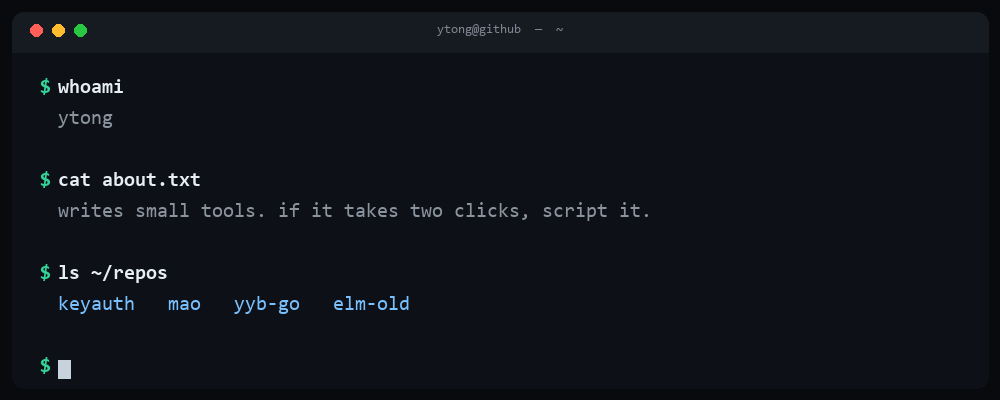

## 你好，我是 Ytong

写点自己用的小工具。不是科班出身，纯粹是「这事每天要手动点一遍，不如写个脚本」那种人。

目前在弄三件事：**签到脚本**、**卡密授权系统**、**自动化流程**。
项目基本自用优先 —— 能用、能跑、不折腾。

---

## 在做的项目

| 项目 | 是什么 | 技术 |
|---|---|---|
| **[keyauth](https://github.com/Ytong825/keyauth)** | 自托管卡密授权系统。制卡 / 绑机 / 多设备 / 换绑 / 校验日志 / 代理商分销，纯标准库零依赖，1 核 1G 就能跑 | `Python` `SQLite` |
| **[mao](https://github.com/Ytong825/mao)** | 自用羊毛脚本集：机场签到、预约、抢兑、日常任务 | `Python` `JavaScript` |
| **[yyb-go](https://github.com/Ytong825/yyb-go)** | 云运动自动签到服务，systemd 托管 + 控制台面板 | `Python` `Go` |
| **[elm-old](https://github.com/Ytong825/elm-old)** | 饿了么领券脚本（2024 年存档，已停更） | `JavaScript` |

---

## 常用

  
  
  
  
  

  
  

---

  脚本类项目不保证长期可用 —— 接口一变就得改，这也是它们叫「自用」的原因。 
  用着顺手就给个 Star，不给也行。

